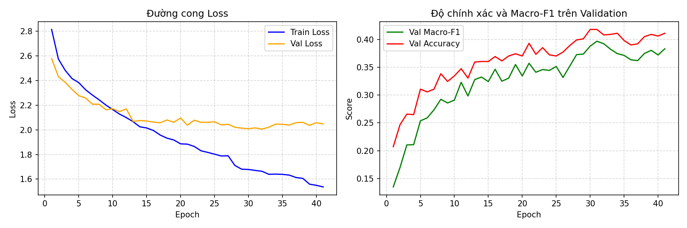
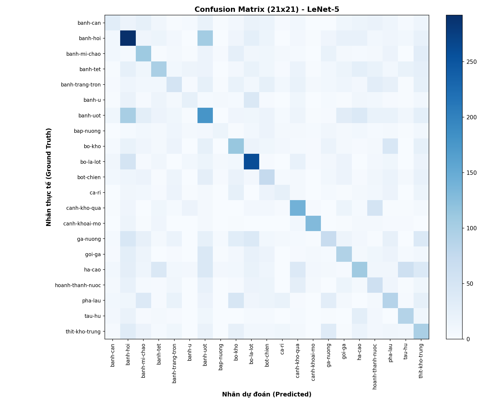
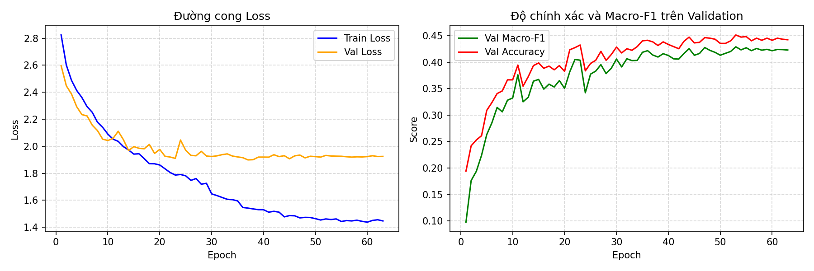
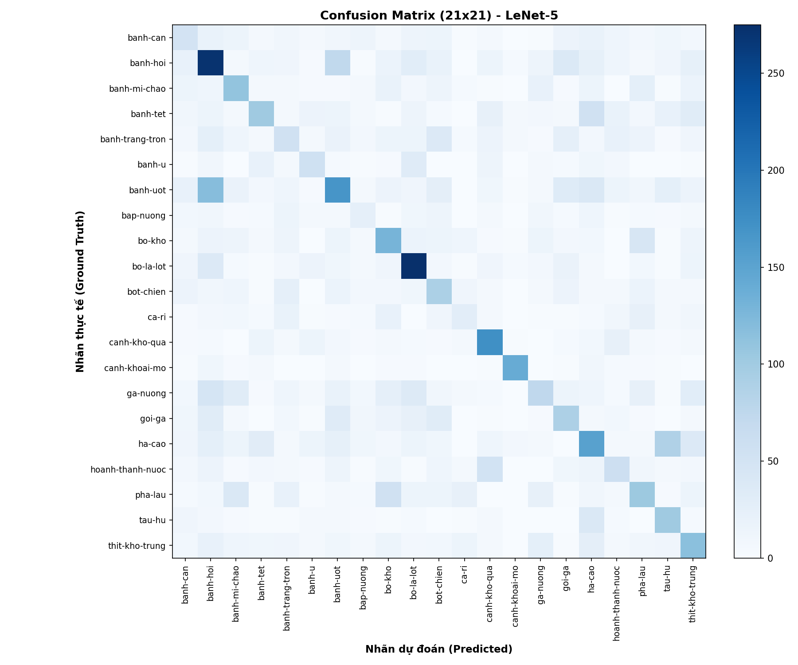

# Bài 1: Xây dựng và Huấn luyện mô hình LeNet-5 trên VinaFood21

Dự án này triển khai kiến trúc LeNet-5 điều chỉnh (theo hướng dẫn B.3 trong tài liệu DS201 Lab 2) để phân loại 21 món ăn Việt Nam từ bộ dữ liệu VinaFood21. Mô hình được huấn luyện trên GPU (Kaggle Tesla T4) với cơ chế `ReduceLROnPlateau` và `EarlyStopping`.

---

## 1. Cấu trúc thư mục

```
bai1_lenet/
├── data.py          # Transforms (Data Augmentation) và DataLoaders
├── model.py         # Kiến trúc LeNet-5 (AvgPool2d / MaxPool2d), bảng đếm tham số
├── engine.py        # train_one_epoch và evaluate tính toán 4 độ đo
├── train.py         # Huấn luyện mô hình, ReduceLROnPlateau, EarlyStopping
├── evaluate.py      # Đánh giá trên test, in bảng F1 và ma trận nhầm lẫn 21×21
├── requirements.txt # Danh sách thư viện
├── README.md        # Báo cáo kết quả chi tiết
├── outputs_avg/     # Checkpoint và kết quả của bản AvgPool
│   ├── best.pt
│   ├── history.csv
│   ├── loss_curve.png
│   ├── confusion_matrix_avg.png
│   └── test_metrics_avg.json
└── outputs_max/     # Checkpoint và kết quả của bản MaxPool
    ├── best.pt
    ├── history.csv
    ├── loss_curve.png
    ├── confusion_matrix_max.png
    └── test_metrics_max.json
```

---

## 2. Đặc tả kiến trúc LeNet-5 điều chỉnh

- **Ảnh đầu vào**: 64 × 64 × 3 (ảnh màu).
- **C1**: Conv2d(3, 6, kernel=5), ReLU -> output: 60 × 60 × 6 (456 tham số)
- **S2**: AvgPool2d(2, 2) hoặc MaxPool2d(2, 2) -> output: 30 × 30 × 6 (0 tham số)
- **C3**: Conv2d(6, 16, kernel=5), ReLU -> output: 26 × 26 × 16 (2,416 tham số)
- **S4**: AvgPool2d(2, 2) hoặc MaxPool2d(2, 2) -> output: 13 × 13 × 16 (0 tham số)
- **Flatten**: 13 × 13 × 16 = 2,704 chiều (0 tham số)
- **F5**: Linear(2704, 120), ReLU -> output: 120 (324,600 tham số)
- **F6**: Linear(120, 84), ReLU -> output: 84 (10,164 tham số)
- **OUT**: Linear(84, 21) -> output: 21 (1,785 tham số)
- **Tổng số tham số**: **339,421** tham số (khớp 100% tài liệu B.3).

---

## 3. Kết quả thực nghiệm trên tập Test (Kaggle GPU)

Dưới đây là bảng số liệu đánh giá thực tế thu được trên toàn bộ **6,682 ảnh** tập Test của bộ dữ liệu VinaFood21:

| Chỉ số đánh giá | LeNet-5 (AvgPool) | LeNet-5 (MaxPool) | Chênh lệch (MaxPool vs AvgPool) |
|---|:---:|:---:|:---:|
| **Số tham số** | 339,421 | 339,421 | 0 |
| **Số Epoch chạy thực tế** | 41 epochs *(dừng sớm)* | 63 epochs *(dừng sớm)* | +22 epochs |
| **Best Checkpoint tại Epoch** | **Epoch 31** | **Epoch 53** | - |
| **Thời gian trung bình** | 68.03 s/epoch | **56.13 s/epoch** | Nhanh hơn 1.21x |
| **Test Loss** | 2.3484 | **2.2536** | -0.0948 (Tốt hơn) |
| **Test Accuracy** | 32.12% | **35.41%** | **+3.29%** |
| **Macro Precision** | 31.59% | **34.33%** | **+2.74%** |
| **Macro Recall** | 30.51% | **34.63%** | **+4.12%** |
| **Macro F1-Score** | 30.32% | **34.09%** | **+3.77%** |

---

## 4. Hình ảnh trực quan hoá kết quả

### 4.1. Phiên bản AvgPool2d

#### Biểu đồ huấn luyện Loss & Val F1:


#### Ma trận nhầm lẫn (Confusion Matrix 21×21):


---

### 4.2. Phiên bản MaxPool2d

#### Biểu đồ huấn luyện Loss & Val F1:


#### Ma trận nhầm lẫn (Confusion Matrix 21×21):


---

## 5. Nhận xét & Đánh giá

1. **MaxPool2d vượt trội so với AvgPool2d**:
   - Phiên bản sử dụng **MaxPool2d** đạt Macro-F1 là **34.09%** và Accuracy là **35.41%**, vượt trội hơn hẳn so với **AvgPool2d** (Macro-F1: 30.32%, Accuracy: 32.12%).
   - *Nguyên nhân*: MaxPool giữ lại các điểm đặc trưng nổi bật nhất (cường độ kích hoạt cao nhất như góc cạnh, chi tiết bề mặt thức ăn), trong khi AvgPool lấy trung bình làm mờ và suy giảm độ sắc nét của đặc trưng cục bộ.
2. **Hiệu quả của ReduceLROnPlateau & EarlyStopping**:
   - Cả hai mô hình đều không cần chạy hết 100 epochs mà tự động dừng tối ưu khi hội tụ (41 epochs với AvgPool, 63 epochs với MaxPool).
   - Learning rate được tự động giảm dần khi loss chững lại, giúp mô hình vượt qua các vùng yên ngựa (saddle points) và hội tụ về cực tiểu tốt hơn.
