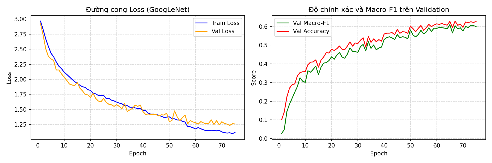
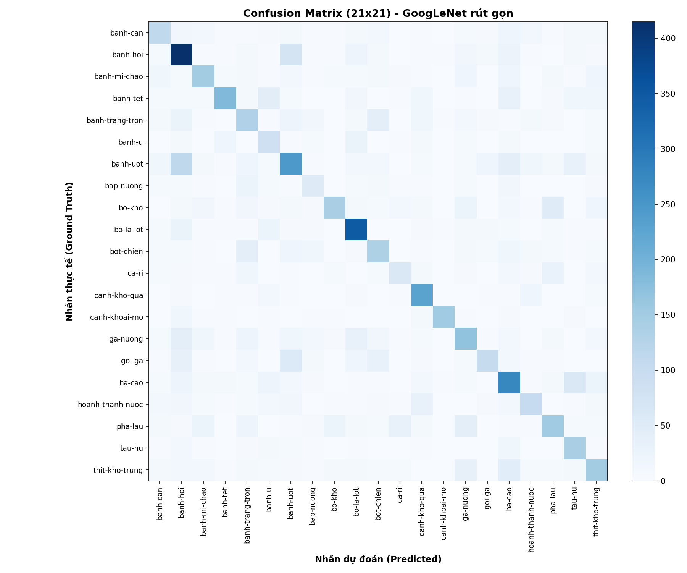

# Bài 2: Xây dựng và Huấn luyện mô hình GoogLeNet rút gọn trên VinaFood21

Dự án này triển khai kiến trúc GoogLeNet rút gọn với 4 Inception Blocks và Global Average Pooling (theo hướng dẫn B.4 trong tài liệu DS201 Lab 2) để phân loại 21 món ăn Việt Nam từ bộ dữ liệu VinaFood21. Mô hình được huấn luyện trên GPU (Kaggle Tesla T4) với cơ chế `ReduceLROnPlateau` và `EarlyStopping`.

---

## 1. Cấu trúc thư mục

```
bai2_googlenet/
├── data.py          # Transforms (đồng bộ với Bài 1, cùng seed 42)
├── model.py         # InceptionBlock, MiniGoogLeNet, hàm đối chiếu channel
├── engine.py        # train_one_epoch và evaluate tính toán 4 độ đo
├── train.py         # Huấn luyện mô hình, ReduceLROnPlateau, EarlyStopping
├── evaluate.py      # Đánh giá trên test, in bảng F1 và ma trận nhầm lẫn 21×21
├── requirements.txt # Danh sách thư viện
├── README.md        # Báo cáo kết quả chi tiết
└── outputs/         # Checkpoint và kết quả thực nghiệm
    ├── best.pt
    ├── history.csv
    ├── loss_curve.png
    ├── confusion_matrix_googlenet.png
    └── test_metrics_googlenet.json
```

---

## 2. Đặc tả kiến trúc GoogLeNet rút gọn

- **Ảnh đầu vào**: 64 × 64 × 3 (ảnh màu).
- **Cấu trúc Inception Block**: Gồm 4 nhánh song song nối bằng `torch.cat(..., dim=1)`.
- **Global Average Pooling**: Dùng `nn.AdaptiveAvgPool2d((1, 1))` gom feature map về vector 1D thay thế `nn.Flatten()` trước Linear classifier.

### Bảng đối chiếu số channel output từng Inception Block (Tính tay vs In từ Code):

| Khối / Tầng | Cấu hình tham số $(in\_ch, f_1, f_{3r}, f_3, f_{5r}, f_5, f_p)$ | Channel ra (Tính tay) | Channel ra (Code in) | Số tham số |
|---|---|:---:|:---:|---:|
| **Stem Conv** | Conv2d(3, 64, kernel=3, pad=1) | 64 | 64 | 1,792 |
| **Inception 1** | $(64, 16, 16, 24, 4, 8, 8)$ | $16 + 24 + 8 + 8 = 56$ | **56** | 7,148 |
| **Inception 2** | $(56, 32, 32, 48, 8, 16, 16)$ | $32 + 48 + 16 + 16 = 112$ | **112** | **22,104** *(khớp B.4 Bước 3)* |
| **Inception 3** | $(112, 64, 64, 96, 16, 32, 32)$ | $64 + 96 + 32 + 32 = 224$ | **224** | 88,112 |
| **Inception 4** | $(224, 64, 64, 96, 16, 32, 32)$ | $64 + 96 + 32 + 32 = 224$ | **224** | 107,824 |
| **Classifier** | GAP + Dropout(0.4) + Linear(224, 21) | 21 | 21 | 4,725 |
| **TỔNG CỘNG** | **Toàn bộ mạng MiniGoogLeNet** | | | **231,705** |

---

## 3. Kết quả thực nghiệm trên tập Test (Kaggle GPU)

Kết quả đánh giá trên toàn bộ **6,682 ảnh** tập Test của bộ dữ liệu VinaFood21:

| Chỉ số đánh giá | Kết quả thực tế |
|---|:---:|
| **Tổng số tham số** | **231,705** |
| **Số Epoch chạy thực tế** | 75 epochs *(dừng sớm qua Early Stopping)* |
| **Best Checkpoint tại Epoch** | **Epoch 65** |
| **Thời gian trung bình** | **57.07 s/epoch** |
| **Test Loss** | **1.5896** |
| **Test Accuracy** | **52.66%** |
| **Macro Precision** | **53.42%** |
| **Macro Recall** | **51.47%** |
| **Macro F1-Score** | **51.55%** |

---

## 4. Hình ảnh trực quan hoá kết quả

### 4.1. Biểu đồ huấn luyện Loss & Val F1:


### 4.2. Ma trận nhầm lẫn (Confusion Matrix 21×21):


---

## 5. So sánh với Bài 1 (LeNet-5)

| Tiêu chí | LeNet-5 (AvgPool) | LeNet-5 (MaxPool) | GoogLeNet rút gọn (4 Blocks) |
|---|:---:|:---:|:---:|
| **Số tham số** | 339,421 | 339,421 | **231,705** *(giảm 31.7%)* |
| **Thời gian / epoch** | 68.03 s | 56.13 s | **57.07 s** *(tương đương)* |
| **Test Loss** | 2.3484 | 2.2536 | **1.5896** *(thấp hơn rất nhiều)* |
| **Test Accuracy** | 32.12% | 35.41% | **52.66%** *(+17.25% so với MaxPool)* |
| **Macro-F1** | 30.32% | 34.09% | **51.55%** *(+17.46% so với MaxPool)* |

### 💡 Nhận xét chuyên sâu:
1. **Sức mạnh của trích xuất đặc trưng đa tỉ lệ (Multi-scale Feature Extraction)**:
   - Các Inception blocks xử lý song song với các kích thước kernel $1\times 1$, $3\times 3$, và $5\times 5$, cho phép mạng đồng thời học được cả các chi tiết nhỏ (sợi bún, hành, ớt) lẫn các cấu trúc tổng thể của món ăn (bát phở, đĩa cơm tấm). Nhờ đó, độ chính xác tăng vọt từ **35.41%** lên **52.66%** (+17.25%).
2. **Ưu thế của Global Average Pooling (GAP)**:
   - Thay vì làm phẳng tensor $13\times 13$ tạo thành lớp Fully Connected khổng lồ như LeNet-5 (chiếm 95.6% tham số), GoogLeNet sử dụng GAP chỉ tốn 4,725 tham số ở tầng phân loại, giúp tổng số tham số của mô hình nhẹ hơn LeNet-5 tới **31.7%** mà không bị hiện tượng overfitting.
